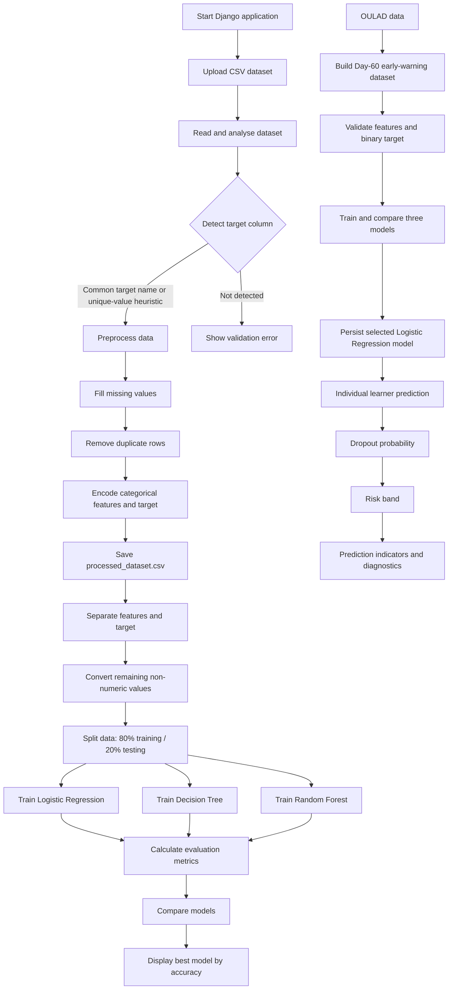

# PSAIAC_230 - Predictive Analytics for EdTech Dropout Prevention

## Overview

PSAIAC_230 is an **early-warning and student-support platform for identifying learners at elevated dropout risk and enabling timely intervention**. It combines an OULAD-based Day-60 workflow with a separate generic CSV analysis workflow. Prediction is used to support prevention through early intervention; it does not guarantee dropout prevention and must not replace educator judgment.

## Problem Statement

> Online courses see 80–90% dropout rates. Industry needs a data science model that identifies at-risk learners early based on engagement signals and triggers personalized intervention strategies.

The implemented OULAD workflow uses registration timing and early assessment records. Learner-level VLE clickstream/activity data is not present in this repository, so this implementation does not calculate clicks, logins, active days, or active weeks.

## Objectives

- Build a separate early-warning dataset and prediction pipeline using the available OULAD fields and a Day-60 assessment schedule cutoff.
- Estimate dropout probability, assign project-defined risk bands, and display Logistic Regression feature-contribution indicators.
- Generate rule-based learner support recommendations from risk and early-assessment information.
- Provide learner-risk dashboards, individual and batch predictions, educator intervention tracking, model diagnostics, and aggregate reports.
- Apply authentication, role-based route permissions, and a mapped learner profile for student self-service prediction access.

## Submission Materials

- [Final-year report outline](docs/FINAL_REPORT_OUTLINE.md)
- [Presentation outline](docs/PRESENTATION_OUTLINE.md)
- [Demo script and viva questions](docs/DEMO_AND_VIVA.md)
- [Screenshot checklist](docs/SCREENSHOT_CHECKLIST.md)

## Overall Flow



The generic and specialized workflows are intentionally separate. A generic dataset must be uploaded through the Dashboard before generic preprocessing or model training can use it. The early-warning workflow independently uses the OULAD-derived dataset and persisted early-warning artifacts.

## How It Works

1. **Upload and analyse:** Upload a CSV file from the Dashboard. The current generic dataset is tracked in the browser session and remains available when navigating between the Dashboard, preprocessing, and model-training pages. Existing files on disk are not treated as a new upload by themselves.
2. **Detect the target:** The application first checks common names such as `target`, `dropout`, `status`, `outcome`, and `final_result`. If no common name is found, it searches for a column with between two and ten unique values.
3. **Preprocess:** Numeric missing values are filled with the column median. Non-numeric missing values are filled with the mode or `Unknown`. Duplicate rows are removed, and categorical columns are converted to numeric values.
4. **Train and compare:** The processed data is divided into training and testing sets. Three classification algorithms are trained and evaluated using the same test data.
5. **Review results:** The interface displays each model's accuracy, precision, recall, and weighted F1 score. The model with the highest accuracy is identified as the best-performing model for that run.
6. **Early-warning preparation:** The specialized workflow derives a separate learner-course-presentation table from OULAD using only information available by the Day-60 cutoff. The observed `final_result` is mapped to a binary `dropout` target, while post-cutoff and outcome columns are excluded from predictive inputs.
7. **Early-warning prediction:** Logistic Regression is the selected persisted early-warning model. The individual-prediction page returns a dropout probability, a project-defined risk band, and model-native feature contribution indicators.
8. **Diagnostics:** The early-warning page reports held-out threshold analysis at 0.30, 0.50, and 0.70, including precision, recall, F1, confusion-matrix counts, and ROC-AUC.

### ROC-AUC and ROC Curve

The model-training workflow evaluates classification models using ROC-AUC in addition to Accuracy, Precision, Recall, and weighted F1.

The application also generates and displays a Receiver Operating Characteristic (ROC) curve for models where probability-based evaluation is available.

- ROC stands for **Receiver Operating Characteristic**.
- The ROC curve plots True Positive Rate (Recall/Sensitivity) against False Positive Rate at different classification thresholds.
- ROC-AUC is the Area Under the ROC Curve.
- A higher ROC-AUC generally indicates better ability to distinguish between the two target classes on the evaluated test data.

For the current early-warning model comparison, the measured ROC-AUC values are:

| Model | Accuracy | Precision | Recall | Weighted F1 | ROC-AUC |
|---|---:|---:|---:|---:|---:|
| Logistic Regression | 82.68% | 82.29% | 82.68% | 82.04% | 84.93% |
| Decision Tree | 74.92% | 74.90% | 74.92% | 74.91% | 71.90% |
| Random Forest | 80.21% | 79.64% | 80.21% | 79.71% | 81.16% |

These values are reproduced from the current 32,593-row dataset using a stratified 80/20 split and `random_state=42` (26,074 training rows and 6,519 held-out rows). Logistic Regression was selected in this project experiment because it achieved the highest measured accuracy and ROC-AUC among these evaluated models. This is an experiment-specific result, not a universal model ranking or evidence of performance at another institution.

### Threshold Diagnostics

The thresholds below are evaluated on the held-out test split. Increasing the threshold reduces the number of predicted-positive learners and false positives in this experiment, while also reducing recall. No threshold is declared universally optimal.

| Threshold | Predicted positive | Precision | Recall | F1 |
|---:|---:|---:|---:|---:|
| 0.30 | 2,016 | 70.78% | 70.26% | 70.52% |
| 0.50 | 1,594 | 78.29% | 61.45% | 68.86% |
| 0.70 | 1,377 | 81.70% | 55.39% | 66.02% |

At threshold 0.50, the confusion matrix is TP=1,248, FP=346, TN=4,142, FN=783; ROC-AUC is 84.93%. The project-defined risk bands use probability `< 0.30` for Low, `0.30 <= probability < 0.70` for Medium, and `>= 0.70` for High. These are initial project thresholds, not clinically, statistically, or institutionally validated cutoffs.

## How to Run

### Requirements

- Python 3.10 or later recommended
- Django
- pandas
- NumPy
- scikit-learn

### Setup

```bash
git clone <repository-url>
cd PSAIAC_230_Predictive_Analytics_EdTech_Dropout_Prevention
python -m venv .venv
source .venv/bin/activate       # Linux/macOS
# .venv\\Scripts\\activate      # Windows
pip install -r requirements.txt
python manage.py migrate
python manage.py runserver
```

Open `http://127.0.0.1:8000/` in a browser. Then use the workflow in this order:

1. Upload a CSV dataset at `/`.
2. Open **Data Preprocessing** at `/preprocessing/`.
3. Open **Train Model** at `/model-training/`.
4. Open **Early-Warning Training** at `/early-warning-training/` to build or inspect the OULAD-based early-warning workflow.
5. Open **Make Predictions** at `/individual-prediction/` to select a learner, course, and presentation and view the persisted early-warning prediction.

The current generic dataset remains active until it is replaced by another upload or explicitly removed from the Dashboard. The specialized early-warning workflow does not require a generic CSV upload.

To verify the Django configuration before starting the server:

```bash
python manage.py check
```

## Main Features

- CSV upload validation and dataset analysis
- Automatic target-column detection
- Row, column, data-type, and missing-value summaries
- Median and mode-based missing-value treatment
- Duplicate-row removal
- Categorical feature and target encoding
- Reusable processed dataset output
- 80/20 train-test split with a fixed random state for repeatable comparisons
- Logistic Regression, Decision Tree, and Random Forest training
- Accuracy, precision, recall, and weighted F1 evaluation
- ROC-AUC scores and ROC curve visualizations for model comparison
- Automatic best-model selection by accuracy
- Session-aware current generic dataset state across workflow pages
- Explicit generic dataset replacement and removal
- OULAD-derived early-warning dataset generation with a Day-60 cutoff
- Leakage validation for early-warning features and binary dropout target
- Persisted early-warning Logistic Regression model and preprocessing artifacts
- Individual learner probability prediction and Low/Medium/High risk bands
- Model-native higher-risk and lower-risk feature contribution indicators
- Held-out early-warning threshold and confusion-matrix diagnostics
- Browser-based Django interface with separate generic and early-warning workflow pages

## Challenges Addressed

- **Inconsistent educational data:** Uploaded datasets can contain mixed data types, missing values, duplicate rows, and categorical fields.
- **Unknown target naming:** Different datasets use different names for dropout or outcome labels, so the system uses common-name matching and a unique-value heuristic.
- **Machine-learning input requirements:** Most scikit-learn classifiers require numeric feature values, so text-based features are encoded before training.
- **Fair model comparison:** All models use the same processed data and test split, making the displayed metrics easier to compare.
- **Imbalanced or limited classes:** Weighted metrics and safe handling for single-class stratification reduce common evaluation failures, although the quality of predictions still depends on the dataset.
- **Actionable interpretation:** Reporting several metrics instead of accuracy alone gives users a broader view of model performance.

## Application Modules

- **Dashboard:** Generic dataset upload/state and aggregate early-warning and intervention summaries.
- **Dataset Upload:** Validates a CSV extension, detects a target, and presents dataset characteristics.
- **Data Preprocessing / Model Training:** Separate generic CSV workflow for cleaning, encoding, and comparing classifiers; requires a current session upload and is Admin-restricted.
- **Early-Warning Training:** Builds the OULAD Day-60 table, evaluates three classifiers and thresholds, and persists the selected model and preprocessing metadata.
- **Individual Prediction:** Looks up a learner-course-presentation record and displays probability, risk band, model indicators, recommendations, and intervention history.
- **Student Risk Dashboard:** Filters, sorts, paginates, and summarizes persisted-model predictions for Admins and Educators.
- **Batch Prediction:** Validates compatible Day-60 feature CSVs, returns probabilities and risk bands, and provides a CSV download.
- **Recommendations:** Produces deterministic support suggestions from risk and available early-assessment fields; these are not outcome guarantees.
- **Intervention Management:** Records support type, priority, notes, follow-up date, and status; provides filters and overdue summaries.
- **Model Performance:** Re-runs the current held-out model comparison and displays metrics, ROC information, and threshold diagnostics.
- **Reports:** Summarizes current risk distribution, module distribution, and intervention counts, with a CSV summary download.
- **Settings / Help:** Authenticated informational pages; they do not provide a full user-preference or configuration-management system.
- **Authentication / Access Control:** Django login, logout, role groups, route decorators, and student-profile mapping.

## System Architecture

```text
OULAD CSV files                         Generic uploaded CSV
	|                                         |
	v                                         v
Day-60 feature builder                  Validation / preprocessing
	|                                         |
	v                                         v
Early-warning dataset                  Generic model comparison
	|
	v
Train / evaluate Logistic Regression, Decision Tree, Random Forest
	|
	v
Persist Logistic Regression + preprocessing metadata
	|
	v
Individual / batch prediction -> risk band + model indicators
	|                                      |
	v                                      v
Rule-based support recommendations -> educator intervention records
						    |
						    v
				      Dashboard summaries and CSV reports
```

Django views and templates provide the web layer. Pandas and scikit-learn implement tabular preparation and model workflows. CSV files and serialized joblib artifacts are the current early-warning data/artifact store; Django's configured database stores authentication, student-profile mappings, and intervention records. Django groups and route-level authorization enforce access; no separate API service is present.

## Technology Stack

- Python 3.12 in the current validation environment; Django 6.1.
- pandas, NumPy, and scikit-learn for data processing and classification; joblib for model artifacts; matplotlib for model-performance visualizations.
- Django templates, HTML, CSS, and JavaScript for the web interface.
- SQLite by default, with optional `DATABASE_URL` configuration through `dj-database-url`.
- WSGI entry point in `config/wsgi.py`; Gunicorn is listed for compatible hosted environments.
- WhiteNoise is listed in `requirements.txt` but is not currently configured in Django middleware.

## Authentication and RBAC

The implemented groups are `ADMIN`, `EDUCATOR`, and `STUDENT`. Admins can use generic preprocessing/training and early-warning training. Admins and Educators can access the risk dashboard, batch prediction, intervention functions, model performance, and reports. Students can use individual prediction and recommendations only for the learner ID mapped to their `StudentProfile`; the server-generated learner options are also restricted to that ID. Direct requests for another learner are rejected, and students cannot access institutional reports, model training, batch prediction, or intervention management. Settings and Help require login.

UI visibility is not the security mechanism: server-side route checks and the student-profile ID comparison enforce these protected views. The root route is role-aware: Admins receive the administrative dashboard/upload page, Educators are redirected to the learner-risk dashboard, and Students are redirected to their own learner profile. POST requests to the root upload route are denied to non-Admins before dataset processing. Focused tests verify restricted learner-option context, direct-ID rejection, protected operations, and retained Admin/Educator access. These checks cover the implemented views; they are not a substitute for deployment-level security review.

## Recommendations and Intervention Workflow

```text
Risk prediction -> learner identification -> rule-based support recommendation
-> Educator records intervention -> status/follow-up tracking -> aggregate reporting
```

Recommendations are driven by risk band, early-assessment submission rate, and early-assessment mean score. The current rule values include submission rate below 75% and mean score below 50 for specific support suggestions. Educators record and update intervention status; risk probability at creation is captured server-side. A later probability comparison is descriptive and does not establish that an intervention caused a change in risk or outcome.

## What Makes This Different from Other Analytical Models?

This platform is more than a one-off predictive model or a static analytics report:

- **End-to-end workflow:** It combines dataset inspection, cleaning, transformation, training, and comparison in one browser-based process.
- **Dataset flexibility:** It is not tied to one fixed schema; it attempts to adapt to different CSV column names and categorical values.
- **Model benchmarking:** It compares three different classification approaches in the same run rather than presenting a single unexplained score.
- **Education-focused purpose:** The early-warning branch uses a Day-60 cutoff so predictions can support timely intervention rather than simply classify records after the course has ended.
- **Separate data boundaries:** Generic user-uploaded data is kept separate from the specialized OULAD-derived early-warning dataset and its persisted artifacts.
- **Action-oriented output:** Individual predictions include probability, risk band, model indicators, and held-out diagnostic context.
- **Transparent preprocessing:** The interface exposes dataset statistics, missing-value changes, duplicates removed, encoded columns, and target mappings.
- **Practical baseline:** The models are lightweight and understandable, making the system suitable as a starting point for an institution-specific predictive pipeline.

The platform should support human decision-making rather than replace educators. Predictions must be reviewed alongside learner context, and sensitive student information should be handled according to institutional privacy requirements.

## Production Configuration

The repository includes environment-driven production settings and WSGI configuration, but the application is a deployment-ready prototype and has not been verified as deployed to a live production environment.

### Local Development Setup

```bash
git clone <repository-url>
cd PSAIAC_230_Predictive_Analytics_EdTech_Dropout_Prevention
python -m venv .venv
# Windows PowerShell
.venv\Scripts\activate
# macOS/Linux: source .venv/bin/activate
pip install -r requirements.txt
python manage.py migrate
python manage.py runserver
```

### Environment Variables

The project does not automatically load `.env` files. Set these values in the shell, process manager, or hosting provider environment.

Required variables:

- `DJANGO_SECRET_KEY`: secret used by Django in production. This should be unique and not committed to source control.
- `DEBUG`: set to `True` for local development, `False` for production.
- `ALLOWED_HOSTS`: allowed hostnames for requests, for example `localhost,127.0.0.1,[::1]`.
- `CSRF_TRUSTED_ORIGINS`: trusted origins for CSRF, for example `http://localhost:8000,http://127.0.0.1:8000`.
- `SECURE_SSL_REDIRECT`: `True` only in HTTPS deployments.
- `SESSION_COOKIE_SECURE`: `True` only under HTTPS.
- `CSRF_COOKIE_SECURE`: `True` only under HTTPS.
- `SECURE_HSTS_SECONDS`: HSTS duration in seconds; use only after confirming HTTPS is correctly configured.
- `DATABASE_URL`: optional. Set to a PostgreSQL or SQLite database URL for non-default deployments. If omitted, the project uses SQLite.
- `EMAIL_BACKEND`, `EMAIL_HOST`, `EMAIL_PORT`, `EMAIL_USE_TLS`, `EMAIL_USE_SSL`, `EMAIL_HOST_USER`, `EMAIL_HOST_PASSWORD`, and `DEFAULT_FROM_EMAIL`: optional email configuration. The production default is Django SMTP; configure real host credentials before relying on email.

Example values:

```env
DJANGO_SECRET_KEY=replace-with-a-long-random-secret-of-50-or-more-characters
DEBUG=True
ALLOWED_HOSTS=localhost,127.0.0.1,[::1]
CSRF_TRUSTED_ORIGINS=http://localhost:8000,http://127.0.0.1:8000
SECURE_SSL_REDIRECT=False
SESSION_COOKIE_SECURE=False
CSRF_COOKIE_SECURE=False
DATABASE_URL=sqlite:///db.sqlite3
```

For local PowerShell, set a variable for the current terminal with `$env:DEBUG = "True"`; use the corresponding `$env:NAME = "value"` form for the other variables. A `.env` file alone has no effect unless a separate loader is installed and configured.

### Production Deployment Notes

- Keep `DEBUG=False` in production.
- Set a long, randomly generated `DJANGO_SECRET_KEY` in the hosting environment; `DEBUG=False` without it intentionally stops startup.
- Allow only intended hostnames in `ALLOWED_HOSTS`.
- Set `CSRF_TRUSTED_ORIGINS` to the deployment's HTTPS origin.
- Set `SECURE_SSL_REDIRECT=True` and secure session/CSRF cookies only when the deployment is HTTPS-ready and proxy headers are correct.
- Configure HSTS deliberately. `SECURE_HSTS_SECONDS` defaults to `0`; do not enable long-lived HSTS until the domain and subdomains are confirmed HTTPS-only.
- Run `python manage.py collectstatic --noinput` before serving static assets in a production environment.
- Use a WSGI server such as `gunicorn` on a supported hosting OS. `collectstatic` gathers assets; WhiteNoise is listed as a dependency but is not configured in `MIDDLEWARE`, so static-file serving must be configured by the host/web server or wired up separately.
- Configure a production database through `DATABASE_URL`; SQLite remains the default and is not a substitute for an operational multi-user production database.

Example production command:

```bash
gunicorn config.wsgi --bind 0.0.0.0:$PORT
```

### Health Check

The application exposes a lightweight `/health/` endpoint that returns an HTTP 200 response for infrastructure monitoring. It does not trigger model training or prediction.

### Security Notes

- Raw uploaded CSV data is not treated as public static content.
- Dataset validation remains in place before processing and prediction.
- Access control is enforced server-side and is not replaced by client-side UI hiding.
- Root dashboard and dataset-upload behavior is role-specific; Admin-only upload and model/data operations are checked server-side.
- Do not commit real secrets or live credentials into repository files.

### Production Checklist

- [ ] Set `DJANGO_SECRET_KEY` from the environment
- [ ] Set `DEBUG=False` for production
- [ ] Set `ALLOWED_HOSTS` to the real deployment hostnames
- [ ] Set `CSRF_TRUSTED_ORIGINS` for the production domain
- [ ] Configure HTTPS-only cookies when behind TLS
- [ ] Run Django migrations
- [ ] Run `collectstatic` before serving static files
- [ ] Use a WSGI server such as `gunicorn`
- [ ] Re-run the role-boundary regression tests before release
- [ ] Validate Admin, Educator, and Student route access with deployment configuration
- [ ] Keep uploaded CSV validation active
- [ ] Configure static-file serving explicitly; do not assume the installed WhiteNoise package is active

## Project Structure

```text
data/                   OULAD source files, generic upload/processed CSVs, early-warning dataset, and artifacts
data/early_warning_artifacts/
config/
	settings.py           Environment-driven Django settings
	urls.py               Application routes, including /health/
	asgi.py
	wsgi.py
core/
	views.py              Request handling, role checks, reporting, and workflows
	models.py             StudentProfile and Intervention records
	ml_engine.py          Generic uploaded-CSV workflow
	oulad_features.py     Day-60 feature and target construction
	early_warning_training.py  Model training, diagnostics, prediction, artifacts
	batch_prediction.py
	recommendation_engine.py
	context_processors.py
	migrations/
	templates/core/       Django page templates
	static/core/          Shared logo asset
	tests.py              56 Django tests
data/
	assessments.csv
	courses.csv
	studentAssessment.csv
	studentInfo.csv
	studentRegistration.csv
	vle.csv               Course/site metadata, not learner clickstream
	early_warning_dataset.csv
	early_warning_artifacts/
		early_warning_model.joblib
		early_warning_preprocessing.joblib
ml/
	studentInfo_clean.csv
	studentInfo_model.csv
docs/                   Report, presentation, demo/viva, and screenshot checklist
manage.py
requirements.txt
README.md
```

## Team Information

**Project:** PSAIAC 230 Predictive Analytics EdTech Dropout Prevention<br>
**Repository owner:** Bhoomika (`bhoomicodess`)<br>
**Contributor:** Hena (`Hena757`), Arpitha (`Arpitha`), Annapurna Kb (`Annapurna Kb`)

The project combines responsibilities across data preparation, machine-learning experimentation, Django development, interface design, evaluation, and documentation. Additional team members and their roles can be added here as the project team roster is confirmed.

## Data and Responsible Use

Learner data can contain sensitive personal or educational information. OULAD-derived records include learner and course identifiers, and uploaded CSV files may contain additional personal or educational information. Use anonymised data where possible, restrict access to uploaded files and persisted artifacts, and avoid using model output as the sole basis for academic or disciplinary decisions.

The early-warning target is derived from observed OULAD outcomes:

- `Withdrawn` maps to `dropout = 1`.
- `Pass`, `Fail`, and `Distinction` map to `dropout = 0`.

The target outcome and post-cutoff information must not be treated as early predictive evidence. Evaluate performance across relevant student groups, validate thresholds with domain experts, and provide appropriate human review before using predictions in practice.

## Early-Warning Dataset

The specialized early-warning workflow derives its dataset from the repository's OULAD files. The generated `data/early_warning_dataset.csv` currently contains 32,593 learner-course-presentation records:

| File | Contents / use |
|---|---|
| `studentInfo.csv` | Learner/course identifiers, demographic and prior-study fields, and the final outcome used to derive the target. |
| `studentRegistration.csv` | Registration timing and unregistration fields; only `date_registration` is used by the current feature builder. |
| `studentAssessment.csv` | Learner assessment submissions and scores. |
| `assessments.csv` | Assessment definitions, scheduled date, type, course, and weight; scheduled date determines eligibility at Day 60. |
| `courses.csv` | Course-presentation duration metadata; present in the data directory but not used by the current early-warning feature builder. |
| `vle.csv` | VLE site/activity-type metadata and week ranges; present in the data directory but not learner-level activity. |

The repository does **not** include `studentVle.csv`. Consequently, the model has no learner-level VLE click counts, login frequency, active days/weeks, or VLE activity trend features. The problem-statement phrase "engagement signals" should be interpreted here as the available registration and assessment indicators, not clickstream behavior.

- Binary target: `dropout`
  - `Withdrawn` -> `1`
  - `Pass` -> `0`
  - `Fail` -> `0`
  - `Distinction` -> `0`
- Non-dropout: 22,437 records (68.84%)
- Dropout: 10,156 records (31.16%)

The early-warning feature set is:

- `code_module`
- `code_presentation`
- `registration_offset_days`
- `early_assessment_count`
- `early_assessment_score_mean`
- `early_assessment_score_std`
- `early_assessment_scheduled_count`
- `early_assessment_submission_rate`

The implemented feature-construction cutoff is:

```text
ASSESSMENT_CUTOFF_DAY = 60
```

Assessment definitions with scheduled `assessments.date` after Day 60 are excluded. Features are the registration offset and assessment count, score mean, score standard deviation, scheduled count, and submission rate, plus `code_module` and `code_presentation` (one-hot encoded for training). `id_student` is retained as a record key but excluded from model features; `dropout` is the target; `final_result`, `date_unregistration`, full-course aggregates, and scheduled post-Day-60 assessment definitions are excluded from model inputs. The generated table is validated for required columns, unique learner/module/presentation records, numeric early features, binary target values, and absence of `final_result` as a predictive input.

**Cutoff limitation:** the current implementation selects assessment definitions by their scheduled date but does not separately require each learner's `studentAssessment.date_submitted` to be on or before Day 60. Late submissions for an assessment scheduled by Day 60 can therefore be included. The method should not be described as a strict observation-time cutoff for every submission until this is reviewed and, if required, corrected in a later implementation phase.

The current 80/20 early-warning split contains 26,074 training rows and 6,519 held-out testing rows. The persisted artifacts are:

- `data/early_warning_artifacts/early_warning_model.joblib`
- `data/early_warning_artifacts/early_warning_preprocessing.joblib`

The project-defined risk bands use a dropout probability below `0.30` for **Low**, `0.30` through below `0.70` for **Medium**, and `0.70` or above for **High**. These thresholds are initial project settings and have not been institutionally or operationally validated.

## Testing

The current final verification baseline is **62 tests passed, 0 failed**. `core/tests.py` covers early-warning target/feature construction, recommendation rules, batch validation and prediction, individual prediction and thresholds, model-performance and reports routes/downloads, authentication and role access, student-ID isolation and learner-option context, role-specific dashboard/upload behavior, interventions, navigation, and generic dataset state.

## Limitations and Future Work

- Results are measurements from this OULAD dataset and this fixed experiment; they may not transfer to another cohort or institution.
- Project-defined risk bands and recommendation rules require validation with educators and domain experts.
- Model contribution indicators are coefficient-based signals, not causal explanations.
- There is no learner-level VLE activity file in the repository.
- The Day-60 implementation uses scheduled assessment date as its cutoff but does not independently restrict `date_submitted`; see the methodology note above.
- A Logistic Regression convergence warning was not emitted in the current reproduced training run; continue to monitor convergence when dependencies/data change.
- Application security remains subject to institutional privacy review and production deployment configuration.
- The project has not been verified on a live production deployment.

Potential future work, subject to project approval, includes acquiring appropriate learner-level VLE activity data, validating observation-time cutoff behavior, evaluating generalization and fairness across cohorts, validating thresholds with domain experts, and completing a production security/static/database deployment review.

## Screenshots

No screenshots are included in this repository. Capture genuine application screens using the checklist in [docs/SCREENSHOT_CHECKLIST.md](docs/SCREENSHOT_CHECKLIST.md); do not use synthetic or altered evidence.

## License and References

No `LICENSE` file or reviewed literature/reference list was found in the audited repository. The team should choose and add a license if required. Add verified academic and dataset citations after checking the official source material; no citations are fabricated in these documents.
